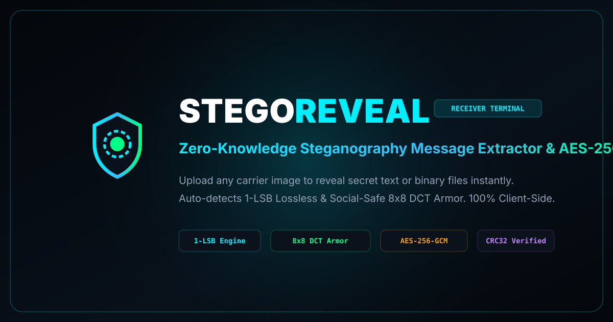

# STEGOREVEAL — Dedicated Steganography Message Extractor & Decryptor

<p align="center">
  
</p>

<p align="center">
  <strong>Zero-knowledge, 100% in-browser steganography extraction terminal and authenticated AES-256-GCM decryptor.</strong>
</p>

<p align="center">
  <a href="https://tejapriyan.github.io/StegoReveal/"></a>
  <a href="LICENSE"></a>
  
  
</p>

---

## 🌐 Live Web Terminal

Access the live, client-side application directly in your browser:  
👉 **[https://tejapriyan.github.io/StegoReveal/](https://tejapriyan.github.io/StegoReveal/)**

*(No installation, registration, or server communication required. Fully functional offline.)*

---

## 🚀 Overview

**STEGOREVEAL** is a standalone, client-side steganography extraction suite built specifically to locate, extract, verify, and decrypt secret messages and binary attachments hidden inside carrier images.

Traditional steganography utilities either upload user images to remote servers or fail when images are subjected to social media compression. STEGOREVEAL runs completely inside the client's browser runtime using hardware-accelerated **Web Crypto API** and HTML5 Canvas, providing an airtight privacy guarantee with zero external network leaks.

---

## ✨ Key Features

- **Upload-and-Reveal Workflow**: Drop, browse, or paste (`Ctrl+V`) any PNG, JPG, WEBP, or BMP carrier image to automatically reveal its hidden text or binary payload.
- **Dual-Engine Auto-Detection**:
  - **1-LSB Lossless Carrier Mode**: Extracts messages embedded across RGB least-significant bit channels for maximum capacity.
  - **Social-Safe 8&times;8 DCT Luminance Armor**: Modulates macro-block luminance with 3&times; Majority Error-Correction Coding (ECC) to survive aggressive WhatsApp and Instagram lossy JPEG compression (Q &ge; 55%).
- **Authenticated AES-256-GCM Decryption**: Supports password-locked carriers with PBKDF2-HMAC-SHA256 (100,000 iterations) and an integrated pure-JS fallback engine (FIPS 197 / NIST SP 800-38D compliant) for sandboxed or legacy environments.
- **IEEE 802.3 CRC32 Integrity Checking**: Detects pixel corruption, image resizing, or tampering before presenting payloads.
- **Inline Media Viewer**: Automatically previews extracted images (PNG/JPG/WEBP), plays secret audio files, and formats code/JSON documents with instant download triggers.
- **Portable Armor Link Decoder**: Decodes `#stego=...` hash share links directly from the URL or clipboard.
- **Built-In Demo Carrier Generator**: Includes one-click demo carrier image generation for instant testing of both plaintext and password-protected steganography without external sample files.
- **Raw Telemetry Inspector**: Allows security researchers to examine the raw binary header, salt, IV nonce, and checksum values in real-time.

---

## 🔒 Cryptographic Architecture

```
[Carrier Image Pixels]
          │
          ▼
 [1-LSB / 8x8 DCT Scanner]
          │
          ▼
   [STEGOSHARE Header] ── CRC32 Validation (IEEE 802.3)
          │
    Is Encrypted?
    ├── YES ──► PBKDF2-HMAC-SHA256 (100,000 iterations)
    │                  │
    │                  ▼
    │           AES-256-GCM Decryption (Tag: 128-bit)
    │                  │
    └── NO  ───────────┴──► [Plaintext Message / Binary File]
```

### Protocol Specification (STEGOSHARE v1)

| Byte Offset | Field Length | Data Type | Description |
|:---|:---|:---|:---|
| `0x00` | 10 bytes | ASCII | Magic Protocol Signature (`STEGOSHARE`) |
| `0x0A` | 1 byte | uint8 | Protocol Version (`0x01`) |
| `0x0B` | 1 byte | bitfield | Flags (`0x01` = Encrypted, `0x02` = File Attachment) |
| `0x0C` | 1 byte | uint8 | Salt Length ($N_s$, 16 bytes for AES-256) |
| `0x0D` | $N_s$ bytes | binary | PBKDF2 Salt |
| `0x0D + N_s` | 1 byte | uint8 | Nonce Length ($N_{iv}$, 12 bytes for GCM) |
| `...` | $N_{iv}$ bytes | binary | GCM Initialization Vector |
| `...` | 2 bytes | uint16 BE | Metadata JSON Length ($M_L$) |
| `...` | $M_L$ bytes | UTF-8 | JSON Metadata (`filename`, `mimeType`, `timestamp`) |
| `...` | 4 bytes | uint32 BE | Encrypted/Plaintext Payload Length ($P_L$) |
| `...` | 4 bytes | uint32 BE | IEEE 802.3 CRC32 Checksum |
| `...` | $P_L$ bytes | binary | Payload Data + 16-byte GCM Tag |

---

## 🛠️ Technology Stack

- **Frontend Core**: Semantic HTML5, Vanilla JavaScript (ES2022), Canvas API
- **Styling**: Tailwind CSS, JetBrains Mono, Inter
- **Cryptography**: Web Crypto API (`crypto.subtle`), PureCrypto fallback (FIPS 197 / RFC 8018)
- **Tooling**: Optional Vite development server, GitHub Actions CI/CD

---

## 💻 Local Setup & Development

StegoReveal is completely self-contained. You can run it directly by opening `index.html` in any modern web browser or using a local development server:

```bash
# Clone the repository
git clone https://github.com/TejaPriyan/StegoReveal.git
cd StegoReveal

# (Optional) Install development dependencies
npm install

# Start local preview server
npm run dev
```

Visit `http://localhost:5173` in your browser.

---

## 📁 Repository Structure

```
StegoReveal/
├── .github/
│   ├── ISSUE_TEMPLATE/
│   │   ├── bug_report.md
│   │   └── feature_request.md
│   ├── workflows/
│   │   ├── ci.yml                 # Automated verification
│   │   └── deploy.yml             # GitHub Pages deployment
│   └── pull_request_template.md
├── .well-known/
│   └── security.txt               # RFC 9116 security standard
├── browserconfig.xml              # Windows tile configuration
├── CODE_OF_CONDUCT.md             # Contributor Covenant v2.1
├── CONTRIBUTING.md                # Contribution guidelines
├── favicon.svg                    # Vector brand icon
├── icon-192.svg                   # PWA application icon (192x192)
├── icon-512.svg                   # PWA application icon (512x512)
├── index.html                     # Main application interface & engine
├── LICENSE                        # MIT License
├── og-image.svg                   # Open Graph social preview banner
├── package.json                   # Project metadata & scripts
├── README.md                      # Documentation
├── robots.txt                     # SEO search engine rules
├── site.webmanifest               # Progressive Web App manifest
└── sitemap.xml                    # Search engine sitemap
```

---

## 🛡️ Security & Privacy Guarantee

- **Zero Remote Communication**: No carrier pixels, passwords, or decrypted text are transmitted over the network.
- **Hardware Acceleration**: Derives AES keys and decrypts in native browser cryptographic sandboxes.
- **Air-Gapped Operation**: Once loaded, StegoReveal works without an active internet connection.

For vulnerability reporting, see [SECURITY.md](SECURITY.md).

---

## 📄 License

This project is open-source and released under the [MIT License](LICENSE).  
Copyright &copy; 2026 **Teja Priyan**.
